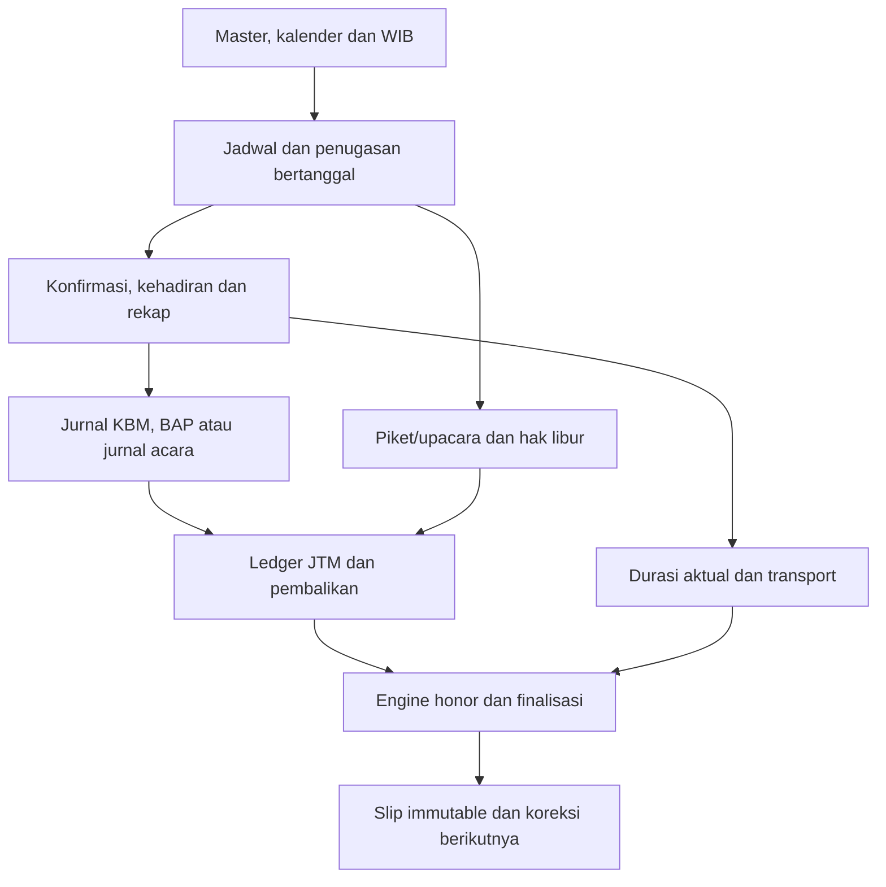

# Tahap 0.1–0.2 — Kewenangan dan alur data

## Matriks aktor

| Aktor | Cakupan | Batas/source |
|---|---|---|
| Publik | Beranda/panduan/login/aktivasi/pemulihan dan verifikasi token | Challenge/rate/Origin sesuai endpoint; token verifikasi tidak mengungkap seluruh slip/nominal |
| Sesi onboarding | Melengkapi akun/password/email/pertanyaan keamanan | Bukan akses business; pageSession/requireSession dan SQL memeriksa scope |
| Guru business | Data/jadwal sesuai scope; bukti milik/effective assignment; honor/slip sendiri dan permintaan koreksi | Ownership/tanggal/konfirmasi/versi/blok/final period; tidak bebas mengakses guru lain |
| Admin business | Pengguna/master/kalender/jadwal/rekap/operasional/finance/migrasi | Tetap tunduk pada CAS, alasan, final lock, transaksi, eligibility dan larangan menulis bukti orang lain yang berlaku |
| Piket yang sah | Operasi KBM/kehadiran/rekap sesuai konteks | `app.is_piket`: penugasan/konfirmasi atau alokasi sah dan time-in; tanggal/larangan self-operation; bukan admin global |
| Panitia/pengawas | Operasi periode/penugasan yang diizinkan; BAP pengawas efektif; event_operator sesuai SQL | app.is_committee dan exam/duty/event guards; bukan seluruh kewenangan untuk setiap panitia |
| Kepala sekolah | Jabatan tambahan `KEPALA_SEKOLAH`, antara lain penandatangan | Role utama tetap admin/guru; akses laporan baru harus dirancang eksplisit |
| Worker | Claim/finish job dan pengiriman terbatas | Bukan sesi pengguna; ticket/lease/switch/retry, tidak memperoleh akses finance umum |

Dasar: `src/lib/users/schemas.ts`, auth/page-session dan security, handler domain, SQL auth/activities/duties/programs/finance/operations. Menu modulesFor adalah bantuan UI, bukan izin server. Dispatcher action/group diperiksa per operasi.

| Fitur | Guru biasa | Petugas kontekstual | Admin |
|---|---|---|---|
| Akun | Milik sendiri | Milik sendiri | Pribadi; akun lain melalui alur admin |
| Master/pengguna/kalender/migrasi/settings | Tidak mengelola | Tidak otomatis mengelola | Guard admin dan aturan data |
| Jadwal | Baca sesuai scope | Sesuai scope | Kelola/bentrok/revisi/rentang |
| Konfirmasi/kehadiran/rekap | Operasi pribadi yang diizinkan | Sesuai tanggal/penugasan/guard | Sesuai guard/version/final lock |
| Jurnal/BAP | Milik/effective assignee yang eligible | Tidak otomatis menulis bukti orang lain | Tidak otomatis menjadi pemilik bukti guru |
| Acara | Riwayat sendiri dan jurnal miliknya | Catat/batalkan hari ini jika event_operator | Master/peserta/blok/preview/arsip |
| Honor | Estimasi/slip sendiri, pengajuan koreksi | Scope guru | Rekap/operasi/finalisasi/koreksi administratif |
| Bantuan | Menyampaikan kode referensi | Bukan admin support | Lookup metadata; ticket lifecycle belum ada |

Matriks merupakan ringkasan untuk pengembangan, bukan pengganti aturan SQL per action. Suite integrasi menguji kepemilikan, penolakan, revocation dan direct DML.

## Peta bisnis

| Langkah | Sumber/pemicu | Konsekuensi |
|---|---|---|
| Konteks | Master/semester/calendar/day overrides | Kelayakan tanggal/jenis kegiatan; tidak otomatis pembayaran |
| Jadwal → occurrence | Teaching/duty/exam/event sources, effective assignment | Materialisasi mengikuti service yang memerlukannya; summary bukan materialisasi |
| Bukti | Confirmation, daily attendance/leaves, student recaps | Petugas, pemilik, tanggal dan kelengkapan mempengaruhi eligibility |
| Jurnal/BAP | teaching_journals/exam_baps/event_journals | Kredit atomik sesuai jenis; acara hadir tanpa jurnal nol; H-1 80% jika diizinkan |
| Edit/cabut/pengganti | CAS serta preview/fingerprint/commit | Reversal kredit sesuai aturan; riwayat dipertahankan; stale write ditolak |
| Libur | Candidates/entitlements/runs/effects | Proyeksi/posting/waive/cancel berbeda; posting hari ini mulai 16.00 WIB |
| Transport | Aktual/izin/km/tarif/blok | Presisi dan penyelesaian bulanan canonical, bukan sekadar adanya jurnal |
| Estimasi/final | calculate/bundle/finalize_core | Tarif/tunjangan akhir bulan, JTM/transport/koreksi; issues menurut SQL; seluruh slip atomik |
| Koreksi | correction_requests/corrections | Pengajuan bukan persetujuan; basis selisih bertahap, target sah, checksum sumber tetap |
| Pengiriman | Outbox/worker/adapter | Antrean/terkirim/retry/failed/unknown dibedakan; tidak blind resend saat ambigu |

## Skenario lintas modul wajib

| ID | Skenario/invarian | Pengujian acuan |
|---|---|---|
| E2E-01 | Jadwal → konfirmasi → rekap/jurnal → honor; kredit satu kali | activities + finance |
| E2E-02 | H/H-1, H-2/future; bobot dan penolakan tanpa ledger parsial | activities/programs/finance |
| E2E-03 | Pengganti/alokasi/cabut; effective owner dan konservasi/reversal | duties/programs |
| E2E-04 | Sesi selesai + jeda 5 menit → BAP; total peserta | programs/exam browser |
| E2E-05 | Acara hadir → blok → jurnal → arsip; nol tanpa jurnal, reversal/riwayat | programs + finance/events browser |
| E2E-06 | Libur posting/cancel/waive; tidak mengganda, proyeksi vs realisasi | finance |
| E2E-07 | Kehadiran/izin/blok → transport; presisi bulanan | activities/finance |
| E2E-08 | Final → koreksi berikutnya; atomik/immutable/idempotent | finance |
| E2E-09 | Sesi/role tak sah dan ekspor; ditolak server | auth/accounts/domain HTTP+SQL |
| E2E-10 | Timeout sesudah write/stale preview; cek sumber sebelum retry | kontrak/UI domain |
| E2E-11 | Ambiguitas pengiriman; fencing/unknown/reconcile | operations/mail |
| E2E-12 | Salin semester allowlist tanpa transaksi/ledger/slip | Rancangan Tahap 6, belum tersedia |

Bukti per suite tidak berarti seluruh rangkaian telah dijalankan sebagai satu browser flow produksi. QA-01/Tahap 8.2 menyatukan rantai ini dengan dataset terisolasi, termasuk penolakan dan rollback.
