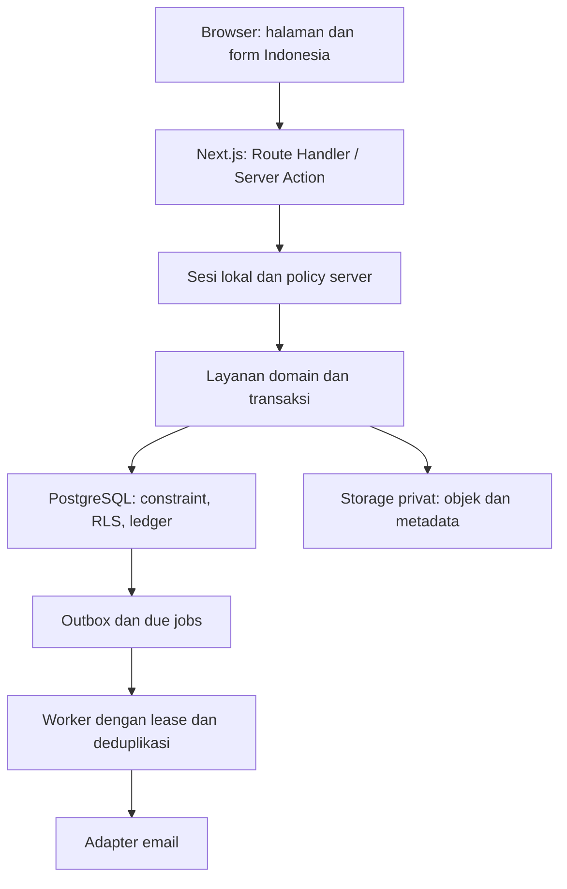

# Tahap 0.3 — Rancangan Teknis Terperinci SiM-Guru

Versi desain: 1.0 | Tanggal: 19 Oktober 2026 (Asia/Jakarta)

policy_version: sim-guru-policy-v1 | formula_version: sim-guru-formula-v1

Status: kontrak rancangan untuk implementasi; belum aplikasi, migrasi SQL yang dieksekusi, OpenAPI yang digenerate, maupun hasil tes runtime. Semua nama tabel, route, service, constraint dan berkas dalam dokumen ini merupakan target yang harus diwujudkan serta diuji.

## 1. Acuan dan prioritas

Urutan acuan: instruksi terbaru pengguna → kebijakan 0.2 untuk K01–K09 → spesifikasi target/koreksi dokumen dasar → matriks cakupan 0.1 → bukti legacy. Jika perbedaan memengaruhi pembayaran atau kewenangan, catat keputusan dan versi, jangan menyembunyikannya dalam implementasi. Matriks 0.1 tetap menjadi daftar kontrol 343 fungsi, 42 nama halaman dan F01–F20; tidak perlu mempertahankan endpoint/nama helper GAS.

### 1.1 Identitas dokumen masukan

| Dokumen | SHA-256 |
|---|---|
| Dasar_Pembangunan_Ulang_SIM_GURU.md | `4a0b387de74ac6fbc8da57758ea34b1f0ea3ec8afce2c01c119398e1bd076ef5` |
| Tahap_0_1_Matriks_Kesetaraan_SIM_GURU.md | `0c80ef0ee48d8859439e764d5721e32eeb5cda4e2f2c3c733bf988d2cdc32a81` |
| Tahap_0_2_Kebijakan_Operasional_SIM_GURU.md | `57ad4717e8e2528d58701e1b42783a942f20a7b5b4dd6cd75adde158caf021cf` |

### 1.2 Batas desain

Satu instalasi sekolah/madrasah. Seluruh UI dan dokumen Indonesia. Tidak ada Central SSO, Supabase Auth, registrasi publik, biometrik atau multi-tenant baseline. PostgreSQL/Storage Supabase menyediakan data dan objek; autentikasi serta sesi dikelola server SiM-Guru. Data produksi dan source checkout belum diperiksa ulang pada tahap ini.

Dokumen ini mengunci pola teknis dan kontrak domain. Versi framework/pustaka, kompatibilitas driver/pool/hash, provider email serta kapasitas cron diverifikasi dari dokumentasi resmi saat implementasi/provisioning; tidak dianggap sudah dipilih atau terbukti berjalan.

## 2. Arsitektur dan batas kepercayaan



Browser hanya memanggil BFF. Server Components memakai query service dengan actor yang sama; tidak memanggil REST internal melalui HTTP jika dapat memanggil layanan langsung. Server Action dan Route Handler adalah adapter tipis ke command yang sama. Actor, now, policy_version, tarif dan effective owner berasal dari server. Input browser tidak memuat actor/role/hash, dan field tak dikenal ditolak pada command mutasi.

Semua modul auth, database, Storage privileged, mail dan jobs server-only. Semua route yang memakai hashing/koneksi PostgreSQL berjalan di Node.js runtime. Layout/menu hanya presentasi; masing-masing query/command harus mengecek sesi dan policy. Tidak ada cache data privat global tanpa key actor/scope. Finalisasi tidak membaca cache UI.

### 2.1 Struktur target

```text
src/
  app/(public)/{login,lupa-password,aktivasi,reset-password,verifikasi-dokumen}/
  app/(protected)/{dashboard,profil,jadwal-saya,jurnal,piket,ujian,kehadiran,acara,honorarium,admin}/
  app/api/{auth,profile,users,schedules,journals,student-attendance,picket,ceremonies,substitutions,exams,jtm,attendance,events,honorarium,corrections,settings,announcements,exports,documents,cron}/
  components/{ui,shell,feedback}/
  features/<domain>/{components,schemas,actions,queries}.ts(x)
  server/auth/{credentials,sessions,challenges,rate-limit,onboarding}.ts
  server/authorization/{actor,capabilities,policies}.ts
  server/services/<domain>/
  server/repositories/<domain>/
  server/db/{auth,business,transaction,context,locks}.ts
  server/{jobs,mail,storage,audit}/
  lib/{decimal,dates,money,errors,validation}/
  types/{dto,domain}/
supabase/{migrations,seed.sql}
tests/{unit,integration,e2e,fixtures}/
docs/{parity,decisions,architecture,api,migration,operations}/
```

Pustaka SQL/query bertipe harus mendukung satu koneksi pinned untuk transaksi, SET LOCAL, row/advisory locks dan numeric sebagai string. Pilih adapter pada Tahap 1.1 dan kunci versinya. Tidak menggunakan sejumlah pemanggilan Data API terpisah sebagai transaksi finansial.

## 3. Model data dan konvensi

### 3.1 Konvensi umum

PK UUID. Entitas impor mempunyai legacy_id dan migration_batch_id; bila legacy ID tidak unik secara global, uniqueness adalah source_system/source_table/legacy_id. FK mengarah PK kanonis, bukan username/nama. Kolom bisnis mutable: created_at, updated_at, created_by/updated_by, version bigint untuk optimistic concurrency. Audit immutable. Soft cancel/archive untuk entitas historis; tidak cascade delete slip/ledger/audit.

Tanggal kegiatan date, jam time tanpa timezone dalam hari WIB, audit timestamptz UTC. Rentang lintas tengah malam ditolak. Periode akademik dan honor berbeda. NIP/telepon/ID legacy teks. numeric/decimal di JSON string kanonis tanpa notasi eksponen; counts integer. Boolean bukan string. JSONB snapshot punya schema_version tervalidasi, bukan sumber relasi inti yang dapat diubah bebas.

Nominal normal nonnegatif; signed delta hanya untuk reversal/correction bertipe eksplisit. Journal input_type dan weight disimpan sekali. Policy/formula versi tersimpan pada posting dan snapshot final. Nama tabel pada matriks 0.1 yang berbeda di sini menjadi alias logis, bukan tabel kedua berisi transaksi sama.

### 3.2 Skema dan role database

| Schema | Isi | Eksposur |
|---|---|---|
| auth_private | Kredensial, sesi, challenge, rate limit, pertanyaan keamanan | Tidak diekspos Data API; akses role auth minimum |
| app | Profil, master, jadwal, attendance, ujian, acara dan transaksi | Server runtime business + policy/RLS default deny |
| finance | Ledger, entitlement, honor, correction | Server runtime business lewat transaksi/routine tervalidasi |
| ops | Audit, idempotency, outbox, jobs, migrasi, ekspor | Role sesuai tugas; payload auth dipisahkan |

Migrasi/owner menggunakan koneksi administratif terpisah. Runtime tidak owner, superuser atau BYPASSRLS. REVOKE akses PUBLIC/anon/authenticated yang tidak dibutuhkan; schema app/finance/ops tidak sengaja diekspos sebagai CRUD publik. Koneksi auth dan bisnis memakai database yang sama dengan privilege berbeda.

Business transaction memasang actor_id/request_id memakai set_config lokal transaksi pada koneksi yang sama setelah sesi diverifikasi BFF. GUC bukan bukti identitas kriptografis dan bukan pertahanan terhadap runtime yang sudah dibajak; kredensial SQL tidak diberikan ke browser, semua query terparameter dan tidak ada RPC publik untuk set actor. RLS mengurangi akses tidak disengaja serta memeriksa scope terhadap konteks terpercaya, bukan mengandalkan auth.uid(). Uji role runtime sungguhan, termasuk koneksi pooled antaractor.

Lifecycle akun lintas profil/kredensial memakai routine privat berprivilege terbatas pada satu koneksi auth dengan hak EXECUTE saja untuk jalur ini; caller auth dipercaya dari BFF yang telah memverifikasi sesi/admin. Routine memeriksa status actor/role/auth_version di database, bukan parameter boolean isAdmin. Kunci search_path, qualify objek, REVOKE PUBLIC EXECUTE. Routine login/aktivasi bootstrap punya kontrak terpisah agar caller anonim tidak dapat mengaku admin. Bootstrap memakai command administrasi terbatas, bukan endpoint publik.

### 3.3 Kamus tabel identitas dan master

| Tabel | Kolom inti | Integritas/relasi |
|---|---|---|
| app.app_users | id, username, full_name, nip, role, status, auth_version, must_change_password, contact_email, email_verified_at, phone, photo_path, address, employment_status, rank, km_distance, additional_role | unique lower(trim(username)); role admin/guru; additional_role null/KEPALA_SEKOLAH; status sesuai K02; email terverifikasi unik case-insensitive |
| auth_private.user_credentials | user_id, password_hash, password_changed_at, credential_version, temporary_expires_at | PK/FK user; hash boleh belum ada sebelum aktivasi, tidak ada placeholder yang dapat login |
| auth_private.app_sessions | id, token_hash, user_id, auth_version_at_issue, scope, expires_at, idle_expires_at, last_activity_at, revoked_at | token_hash unik; scope onboarding/business; absolute expiry tetap |
| auth_private.security_questions | user_id, question_id/custom_question, answer_hash, updated_at | satu per user; DTO tidak pernah memuat hash |
| auth_private.verification_challenges | id, user_id, purpose, target_email, secret_hash/hmac, key_version, attempts, max_attempts, expires_at, consumed_at, superseded_at, approved_request_id | Purpose activation/email_verify/reset_otp/reset_token/admin_handover; binding user/target/purpose; token consumption atomik |
| auth_private.auth_rate_limits | key_hash, scope, window_start, count, blocked_until | key komposit scope/key_hash/window; limit login dan recovery lintas instance |
| auth_private.password_reset_requests | id, user_id, status, method, verified_by, verified_at, evidence_reference, reason | pending/approved/rejected/completed/expired; verifikasi admin; minimisasi bukti sensitif |
| app.system_settings | key, typed_value, schema_version, version | Allowlist setting; tarif, feature flags, identitas/penandatangan; tidak menyimpan secrets di setting umum |
| app.academic_years | id, label, date_start/end | rentang valid |
| app.academic_periods | id, academic_year_id, semester, date_start/end, is_active | semester 1/2; satu periode aktif; tanggal dalam tahun |
| app.classes | id, academic_period_id, name, grade_level, parallel, expected_students | unik nama normalisasi per periode; jumlah standar mengikuti jenjang |
| app.subjects | id, name, normalized_name, archived_at | unique normalized_name; archive jika direferensikan |
| app.allowances | id, user_id, duty_name, amount, effective_from/to | nominal bulat; efektivitas eksplisit; snapshot saat honor |
| app.academic_calendar | id, date, description, is_holiday, version | satu tanggal kanonis; rentang input dipecah tanggal; histori perubahan diaudit |
| app.day_context_overrides | date, academic_period_id, kbm_enabled, exam_enabled, reason, version | perubahan berotorisasi; activeExamPeriods dihitung dari periode ujian aktif |

Tarif/tunjangan versi efektif mencegah perubahan master menulis ulang estimasi masa lalu tanpa jejak. Normalisasi data legacy kosong mengikuti periode aktif hanya saat staging, bukan fallback runtime. Alias alamat/golongan/status_kepegawaian sumber dipetakan eksplisit ke kolom profil.

### 3.4 Penugasan, occurrence dan resource

| Tabel | Kolom inti | Integritas/relasi |
|---|---|---|
| app.teaching_schedules | id, academic_period_id, user_id, subject_id, class_id, day_index, time_start/end, scheduled_jtm, valid_from/to, rest_minutes, version | day 0–6; end>start; within academic period; versi berlaku ke depan |
| app.picket_schedules | id, academic_period_id, user_id, day_index, valid_from/to | unik guru/hari/periode pada rentang aktif |
| app.ceremony_assignments | id, academic_period_id, date, user_id, time_start/end optional | date Senin unik; interval eksklusif perlu jam lengkap |
| app.exam_periods | id, academic_period_id, name, date_start/end, default_committee_jtm, status | future/open/ended/cancelled secara waktu/status; larangan edit mulai periode |
| app.exam_sessions | id, period_id, date, name, time_start/end, scheduled_jtm | tanggal dalam periode; end>start |
| app.rooms | id, name, normalized_name | ruang fisik kanonis unik |
| app.exam_rooms | id, session_id, room_id, subject_id, total_students | unik session/room; kelas lewat relasi |
| app.exam_room_classes | exam_room_id, class_id | PK pasangan; dukung kelas gabungan |
| app.exam_supervisor_assignments | id, exam_room_id, user_id, override_jtm, status, original_assignment_id | assignment efektif aktif; override>0 atau null; adjustment nol bukan fallback |
| app.exam_committee_assignments | id, period_id, date, user_id, scheduled_jtm, status, original_assignment_id, exclusive_time_start/end optional | unik aktif guru/tanggal lintas periode; interval eksklusif opsional |
| app.event_definitions | id, normalized_name, type, recurrence_day_index, time_start/end, scheduled_jtm, description, valid_from/to | rutin/insidental; jtm integer 1–99; nama unik |
| app.event_dates | event_id, date | unik pasangan; untuk insidental |
| app.activity_occurrences | id, kind, date, academic_period_id, source_*_id, original_user_id optional, time_start/end, scheduled_jtm, state, snapshot, version | FK sumber bertipe; exactly-one source sesuai kind; sumber+date unik; snapshot periode/master |
| app.activity_assignments | id, occurrence_id, user_id, role, status, original_assignment_id, assigned_by, assignment_kind | KBM/piket/upacara/panitia/pengawas satu slot efektif; acara banyak peserta; tidak mencampur original/effective teacher |
| app.substitutions | id, occurrence_id, original_assignment_id, substitute_assignment_id, status, replaced_by_id, reason | satu substitusi aktif per slot; guru asli dan pengganti berbeda |
| app.resource_occupancies | id, resource_kind, user_id/class_id/room_id, occurrence_id, date, starts_at, ends_at, exclusivity, active | satu resource FK sesuai kind; interval [); satu slot tidak duplikat karena join |

Occurrence pengawas berasal dari supervisor assignment, panitia dari committee assignment, KBM dari schedule, piket dari jadwal harian yang diturunkan, upacara dari ceremony, acara dari event definition+date. Jangan membuat tabel teaching_occurrences terpisah berisi duplikat; nama itu menjadi view typed-filter atas activity_occurrences. Exam/event assignment dan generic activity_assignment terkait 1:1 untuk tiap actor/slot. DTO memakai occurrenceId/assignmentId kanonis; source FK khusus menjaga referential integrity, bukan polymorphic UUID tanpa FK.

Occurrence dibuat secara idempotent saat query tanggal/command/job membutuhkan, dengan unique source/date. Proyeksi horizon mendatang boleh dimaterialisasi, tetapi bukan syarat agar konflik dapat dicek: schedule mingguan dibandingkan rentang masa berlaku/hari dan pengecualian DayContext. Perubahan jadwal/DayContext memvalidasi tanggal efektif terhadap jadwal mingguan dan semua penugasan tanggal eksplisit walau occurrence belum materialized. Occurrence masa lalu/sudah dipakai tidak disalin ulang dari master. Pengawas substitute membuat assignment baru dan mengalihkan slot, tidak menambah ruang/kelas baru.

### 3.5 Kehadiran, jurnal dan pemblokiran

| Tabel | Kolom inti | Integritas/relasi |
|---|---|---|
| app.attendance_claims | id, assignment_id, user_id, claimed_at, status | pending/acknowledged/rejected/withdrawn; tidak memberi JTM |
| app.activity_confirmations | id, assignment_id, status, confirmed_by/at, revoked_by/at, evidence_source, version | maksimum satu aktif per assignment; riwayat append/revoke; legacy_normalized punya batch/evidence |
| app.daily_attendance | id, user_id, date, sched_time_in/out, actual_time_in/out, time_in_recorded_by, time_in_source, status, extra_attendee, extra_reason, version | unique user/date; out>=in; scheduled out>in; provenance admin/self/piket/panitia/correction |
| app.attendance_schedule_templates | id, day_index, sched_type, sched_time_in/out, version | unique day/type; day 0–6; KBM/UJIAN |
| app.attendance_template_applications | id, date, template_id, template_version, participant_hash, applied_by | idempotency + preview; tidak overwrite actual |
| app.attendance_leaves | id, attendance_id, leave_time, return_time, reason, deleted_at | return>leave; larang overlap aktif per attendance |
| app.student_attendance | id, class_id, date, academic_period_id, hadir,sakit,izin,alpa, submitted_by, version | unique class/date/period; integer nonnegatif, total>0 |
| app.teaching_journals | id, occurrence_id, assignment_id, user_id, material, present, absent, notes, input_type, weight, submitted_at, version, deleted_at | satu aktif per occurrence slot; counts nonnegatif; pemilik efektif; transaksi ledger |
| app.exam_baps | id, supervisor_assignment_id, present, absent, notes, submitted_at, updated_at, state, version | satu BAP per assignment; submitted/locked/corrected; total sesuai ruang bila >0 |
| app.event_attendance | id, occurrence_id, assignment_id, user_id, time_in, status, confirmed_by, journal_submitted, credited_jtm | unique occurrence/user; cancel jika belum jurnal atau koreksi eksplisit |
| app.event_journals | id, event_attendance_id, description, input_type, weight, submitted_at, version | satu aktif per attendance; description 1–1000 |
| app.journal_blocks | id, subject_id, date_start/end, message, active | rentang inklusif; query submit/edit |
| app.event_blocks | id, event_type, date_start/end, message, active | rutin/insidental; inklusif |
| app.transport_blocks | id, date_start/end, reason, active | nominal 0; attendance tetap |

Occurrence journal unik untuk satu slot menghalangi guru asli dan pengganti memegang dua jurnal aktif sekaligus; jurnal lama cancelled tetap bukti dan ledger dibalik. Bukti header/kolom runtime legacy harus diprofil ulang saat migrasi.

### 3.6 Ledger, honor dan koreksi

| Tabel | Kolom inti | Integritas/relasi |
|---|---|---|
| finance.honor_periods | id, year, month, state, formula_version, policy_version, finalized_at/by, source_revision | unique year/month; open/blocked/final; periode nol tetap ada |
| finance.jtm_sources | id, occurrence_id, assignment_id, beneficiary_id, source_type, source_ref FK typed, state, current_revision | unik identitas sumber hak; FK jurnal/BAP/alokasi/entitlement sesuai tipe |
| finance.jtm_ledger | id, source_id, revision, entry_kind, quantity, reverses_entry_id, financial_period_id, effective_date, reason, policy_version | append-only; posting>0 atau zero source tanpa entry; reversal tepat negatif entry asli; unique reverses_entry_id; unique source/revision/kind |
| finance.jtm_adjustments | id, occurrence_id, original_assignment_id, scheduled_jtm, adjusted_jtm, reason, state, version | satu aktif occurrence/slot; A integer 0..S |
| finance.jtm_reallocations | id, adjustment_id, beneficiary_id, allocated_jtm, state, source_id | >0 max4 decimals; total konservasi dikunci parent; penerima aktif bukan admin/asli |
| finance.holiday_entitlements | id, occurrence_id, beneficiary_id, eligible_jtm, state, posting_generation, source_id | satu hak occurrence/slot; projected/pending/posted/waived; run cancel kembali pending dengan reversal |
| finance.honor_statements | id, period_id, user_id, trx_id, document_token_hash, snapshot, total_jtm, total_honor, checksum | unique period/user dan trx_id; immutable final; snapshot schema/version lengkap |
| finance.honor_statement_lines | id, statement_id, component_type, source_id, ledger_entry_id, raw_value, settled_value, snapshot | FK/identity sumber; koreksi/transport/tunjangan lines bertipe terpisah |
| finance.correction_requests | id, requested_by, source_statement_id, reason, state | guru/admin dapat request; admin approve terpisah |
| finance.corrections | id, source_statement_id, target_period_id, beneficiary_id, source_revision, corrected_basis, baseline_basis, delta_amount, reason, state, approved_by, idempotency_id | draft/approved/posted/void; hanya target open; final source immutable; distinct correction number |
| finance.correction_revisions | id, correction_id, entity_type/ref, prior_revision, revised_snapshot | revisi faktual terkait sumber; bukan update history |

Source_type: KBM, PIKET, UPACARA, EXAM_SUPERVISOR, EXAM_COMMITTEE, EVENT, HOLIDAY_BONUS, PARTIAL_SUB_KBM, PARTIAL_SUB_EXAM, PARTIAL_SUB_PIKET. REVERSAL adalah entry_kind, bukan hak baru yang dihitung positif. Correlation source bertipe membedakan regular vs holiday untuk occurrence yang sama; constraint/policy melarang kedua hak efektif bersamaan jika mewakili hak yang sama.

Setiap perubahan nilai yang sudah diposting: reversal entry aktif lama + posting revisi baru dalam transaksi; jangan UPDATE quantity. Reversal menunjuk entry positif dan tidak boleh membalik lebih dari sekali. Koreksi final yang dinilai dalam rupiah menggunakan correction settlement lines, bukan memposting ulang JTM final ke bulan lain sehingga dikalikan tarif baru. Delta bertahap terhadap corrected basis terakhir, bukan selalu terhadap slip asli; dua koreksi berurutan tidak menggandakan selisih. JTM ekuivalen hanya breakdown informatif bila settlement berupa uang.

Slip normal tetap dapat diterbitkan untuk semua guru eligible termasuk nilai nol; target menerima keseluruhan dataset atomik. Status disabled/archived saat final tidak menghapus hak earned sebelumnya: engine menyertakan beneficiary dengan hak dalam periode atau penerima tunjangan/correction, serta roster guru periode yang ditetapkan. Admin role tanpa hak guru tidak otomatis mendapat honor. Daftar penerima periode di-snapshot sebelum perhitungan dalam transaksi.

### 3.7 Operasi, pengumuman dan dokumen

| Tabel | Kolom inti | Integritas/relasi |
|---|---|---|
| app.announcements | id, title, sanitized_body, severity, starts_on/ends_on, is_active, is_dismissible, cta_text/url, content_version | interval tanggal inklusif; CTA http/https; severity enum |
| app.announcement_targets | announcement_id, user_id/target_role, dismiss_override | target user mengungguli role; override tidak kontradiktif |
| app.announcement_acknowledgements | announcement_id, user_id, content_version, dismissed_at/read_at | versi baru dapat muncul lagi |
| ops.command_idempotency | id, actor_scope, operation, request_key, payload_hash, state, result_ref, expires_at | unique scope/operation/key; mismatch body→409; tidak menyimpan token auth |
| ops.audit_logs | id, request_id, actor_id, action, entity_ref, occurred_at, reason, redacted_changes, policy_version | append-only; privilege read admin sesuai scope |
| ops.notification_outbox | id, dedupe_key, recipient_ref, template, redacted_payload, state, attempts, next_attempt_at, lease_token/until, provider_message_id | unique dedupe_key; encrypted secrets disimpan terpisah |
| auth_private.outbox_secrets | outbox_id, ciphertext, nonce, auth_tag, encryption_key_version, expires_at | auth worker saja; encrypted OTP/link; hapus selesai/expiry |
| ops.notification_deliveries | id, outbox_id, attempt, outcome, provider_message_id, sent_at, redacted_error | unique outbox/attempt |
| ops.job_definitions | key, enabled, schedule_spec, timezone, config_version | satu sumber konfigurasi due |
| ops.job_runs | id, job_key, attempt, state, due_date, lease_token/until, started/completed_at, counts, redacted_error | unique job_key/attempt; satu claim aktif per business key |
| ops.job_effects | run_id, source_id, posting_revision, effect_kind | cancel hanya efek run itu; FK source/ledger |
| ops.document_exports | id, owner_id, document_type, snapshot_ref, filter_snapshot, object_path, checksum, state, expires_at | authorization ulang saat download; bucket privat |
| ops.migration_batches | id, source_checksum, exported_at, state, reconciliation_summary | staging/impor/reconcile/final |
| ops.migration_staging_rows | batch_id, source_table, row_number, raw_payload, validation_state, errors | unique batch/table/row |
| ops.legacy_id_mappings | batch_id, source_table, legacy_id, target_table, target_id | identity mapping terkontrol; tidak menerima arbitrary table browser |
| ops.legacy_confirmation_candidates | id, raw_evidence_ref, occurrence_id, user_id, state, reviewed_by/reason | ambiguity unresolved tidak menjadi confirmation |

Object upload/export tidak atomik dengan PostgreSQL: row pending → worker menulis objek deterministic/temp → checksum/size verifikasi → row ready; gagal→failed, cleanup orphan terjadwal. DB finalisasi tidak menunggu PDF/email. Dokumen final mengambil snapshot; ekspor CSV/Excel memakai scope dan filter lengkap yang sama dengan query, bukan current-page-only.

### 3.8 Index dan constraint tambahan

Indeks user/date, occurrence/status, academic_period/day, period/date, outbox state/next_attempt_at, job due/state, audit entity/time. Partial unique index untuk active confirmation, active substitution, active journal, active assignment per slot. FK source private tidak diekspos; NOT NULL/check sesuai state ditegakkan. Delete master direferensikan ditolak/archive. Exclusion untuk interval aktif resource jika implementasi memakai resource occupancy; join antarjenis source tidak dapat diamankan hanya dengan index di tabel berbeda.

Lock resource mingguan/dating tetap wajib untuk konflik dengan occurrence belum materialized; index occupancy hanya melindungi row yang ada. Test migrasi harus membuktikan constraint benar, bukan hanya Zod.

## 4. Status dan transisi

| Entitas | Transisi sah | Guard/efek |
|---|---|---|
| Akun | pending_activation→active; active↔disabled; pending/active/disabled→archived | activate setelah bukti token/password; onboarding gate terpisah; disable/archive naikkan auth_version dan revoke sesi |
| Sesi | onboarding→revoked; business→revoked/expired | onboarding selesai menerbitkan sesi baru; token tidak dinaikkan scope diam-diam |
| Challenge | issued→consumed/expired/superseded/locked | single winner atomik; max attempts/TTL; resend tidak membuka token lama |
| Assignment | active→substituted/cancelled; substituted→active saat cancel substitute | history tetap; occupancy dan confirmation/kredit diperbarui atomik |
| Confirmation | active→revoked | reconfirm menghasilkan riwayat/generation baru; tidak menghidupkan kredit dua kali |
| Jurnal | absent→submitted→edited/deleted | edit konten versioned; delete reversal; final source lewat koreksi |
| BAP | absent→submitted→edited; submitted→locked jika confirmation/substitution dicabut | post/reverse source yang sama; force harus preview/authorize |
| Acara hadir | absent→present→cancelled | cancel biasa hanya sebelum jurnal; correction mengurus sesudah jurnal |
| Penyesuaian | none→active→revised/reset | lock occurrence; konservasi; reset reverse semua allocation source |
| Hak libur | projected→pending→posted; posted→pending saat cancel run; pending→waived | waiver admin alasan dan audit; run ulang memakai posting generation baru |
| Periode honor | open↔blocked; open→final | final hanya setelah akhir periode, validasi lengkap; tidak reopen |
| Koreksi | draft→approved→posted; draft/approved→void | posting lock sumber/target; versi basis dan saldo dicek ulang |
| Job | queued→running→completed/failed/blocked | lease fencing; retry attempt baru pada business key sama; completed effect tidak digandakan |
| Outbox | pending→sending→sent/retry_wait/failed/unknown/cancelled | secret expired→cancelled; unknown receipt bukan bukti bisnis gagal |
| Ekspor | pending→processing→ready/failed→expired | download authorize + signed URL singkat; cleanup objek |

Reconfirm setelah revoke tidak otomatis mengembalikan jurnal/BAP terhapus/cancelled; user harus menggunakan pemulihan/edit yang sah dan eligible. Jika BAP tetap locked sebagai bukti, pengaktifan ulang hanya pada assignment yang sama dengan confirmation baru dan batas periode masih sah; kredit direvisi, bukan ditambah sumber baru.

## 5. Transaksi, locking dan idempotensi

### 5.1 Transaction context

BFF resolve actor → validate shape Zod → begin transaksi → set actor lokal → lock dan revalidate authorization/status/time/resource → mutate + audit + outbox → commit → invalidasi cache terarah. Semua keputusan berbasis now WIB dari clock server; jangan percaya tanggal client sebagai tanggal sistem. Rekam cutoff finalisasi konsisten pada awal transaksi.

Urutan lock global: financial period keys (urut YYYY-MM) → day/context keys (urut date) → resource keys (urut kind/id) → occurrence IDs terurut → source/assignment rows → idempotency/effect rows. Command lintas periode mengambil semua period keys terurut; hindari satu code path mengambil urutan kebalikan. Deadlock/serialization transient diretry terbatas dengan key idempotency sama; error permanen tidak diretry buta.

Semua mutasi berdampak finansial memperoleh shared transaction advisory lock pada honor period dan memeriksa state bukan final. Finalisasi memperoleh exclusive lock key periode yang sama, kemudian row lock honor_period. Mutasi yang dapat mengubah hak lintas periode (jadwal/master/kalender/block/tarif/tunjangan) memperoleh lock setiap periode terdampak dalam rentang; larang rentang perubahan tak berbatas, gunakan effective window dan batasi bagian historis final. Finalisasi membaca tabel langsung setelah exclusive lock; snapshot konsisten dan tidak menunggu email/Storage.

Policy pemblokiran, status akun dan DayContext juga dibaca dalam boundary transaksi mutasi. Perubahan resource/assignment harus memegang resource lock yang sama untuk semua layanan, termasuk weekly-vs-dated dan mode toggle. DB constraints tetap lapisan integritas kedua.

### 5.2 Boundary per command

| Command | Unit atomik dan titik lock | Efek eksternal setelah commit |
|---|---|---|
| Buat/aktivasi akun | profile+credentials/challenge+auth_version+audit+security outbox dalam routine privat | Kirim aktivasi, bukan password plaintext |
| Reset/ganti password | Lock user/challenge; verify ulang version/hash basis; consume token+hash baru+revoke seluruh sesi/challenge | Notifikasi keamanan |
| Submit jurnal | Lock period/occurrence/assignment; eligibility/count/block; journal+source+posting+audit | Reminder invalidation |
| Konfirmasi piket/panitia/upacara | Assignment+confirmation+credit source+audit | Email konfirmasi |
| Ganti pengganti | Lock slot+kandidat resources; revoke efek lama+assignment baru+occupancy+audit | Email perubahan |
| BAP | Assignment+confirmation+timing/counts; BAP+source posting/replace+audit | Notifikasi |
| Adjustment/relokasi | Lock occurrence+active adjustment; A+R≤S; update/append sources/reversals+audit | Notifikasi optional |
| Input jam/izin | Lock attendance+period; time/provenance/scope+overlap; audit | Invalidate transport estimate |
| Jurnal acara | Attendance+journal+snapshot JTM+source posting atomik | Notifikasi |
| Auto-jurnal libur | Due run/lease; occurrence locks; journal/source+posting+job_effects; complete di transaksi efek | Email hasil run |
| Finalisasi honor | Exclusive period; validate all; semua statement+lines+period final+audit+outbox satu transaksi | Render PDF dan kirim email async |
| Posting koreksi | Lock source/target periods terurut dan source correction basis; delta+revision+audit | Notifikasi koreksi |
| Cascade hapus ujian/acara | Preview dependencies/version lalu transaction lock semua sumber; reverse/cancel terkait; final source menolak delete biasa | Email pembatalan |

Transaction auth tidak memegang lock saat menjalankan verifikasi hash yang mahal lebih lama dari perlu: baca hash/version → verify di server → routine transaksi lock user dan cocokkan version/hash fingerprint → write; jika berubah ulangi verifikasi secara terbatas. Jangan menerima passwordVerified=true dari browser atau routine publik. Kegagalan OTP menaikkan attempts melalui transaksi tersendiri yang committed; jangan throw rollback sehingga attempts tidak bertambah.

### 5.3 Idempotency dan preview

Mutasi finansial/submission/batch/confirmation memakai request_key UUID dan payload_hash kanonis. Namespace actor+operation+key. Same key/body: kembalikan hasil bisnis sama; same key/different body: 409 IDEMPOTENCY_KEY_REUSED. Unique domain constraint tetap berlaku setelah record idempotency kedaluwarsa. Retensi command biasa 7 hari, job keys/final references persisten selama data bisnis disimpan. Respons auth tidak dicache bersama token/secret; consume challenge/session semantics mengatur replay auth.

Preview menghasilkan token/ID acak tersimpan dengan actor, operation, resource version, impact hash dan TTL 5 menit; commit impact memeriksa ulang hak, versi, dependencies dan hash. Jika berubah→409 PREVIEW_STALE. force:true tanpa preview sah tidak cukup. Preview tidak mengunci resource selama user membaca modal.

Long job menggunakan lease_token sebagai fencing; final update hanya jika masih pemilik lease. Chunking job memakai effects per occurrence; status complete hanya bila semua unit selesai. Finalisasi baseline tetap satu transaksi, tidak dipecah per guru. Jika volume melampaui runtime, optimalkan/ubah worker eksekusi sebelum produksi; jangan mengganti menjadi final parsial tanpa desain baru.

## 6. Kontrak layanan dan tipe

```ts
type UUID = string & { readonly __brand: 'UUID' };
type ISODate = string & { readonly __brand: 'ISODate' };
type DecimalString = string & { readonly __brand: 'DecimalString' };
interface ActorContext {
  userId: UUID;
  sessionId: UUID;
  authVersion: number;
  scope: 'onboarding' | 'business';
  requestId: string;
  // Dibangun server, tidak dideserialisasi dari body browser.
}
interface CommandMeta {
  idempotencyKey: UUID;
  expectedVersion?: number;
  impactPreviewId?: UUID;
}
type ApiResult<T> =
  | { ok: true; data: T; requestId: string }
  | { ok: false; error: {
      code: string; message: string;
      fieldErrors?: Record<string, string[]>;
      details?: Record<string, unknown>;
    }; requestId: string };
interface DayContext {
  date: ISODate;
  academicPeriodId: UUID;
  isHoliday: boolean;
  kbmEnabled: boolean;
  examEnabled: boolean;
  activeExamPeriodIds: UUID[];
  contextVersion: string;
}
type JournalEligibility =
  | { eligible: true; occurrenceId: UUID; assignmentId: UUID;
      inputType: 'SAME_DAY' | 'H_MINUS_1';
      baseJtm: DecimalString; weight: '1' | '0.8';
      effectiveJtm: DecimalString; expectedStudents: number | null;
      studentRecapState: 'AVAILABLE' | 'MISSING'; version: number }
  | { eligible: false; code: string; message: string };
interface SubmitJournalInput {
  occurrenceId: UUID;
  material: string;
  studentsPresent: number;
  studentsAbsent: number;
  notes?: string;
  meta: CommandMeta;
}
interface AdjustJtmInput {
  occurrenceId: UUID;
  adjustedJtm: DecimalString;
  reason: string;
  meta: CommandMeta;
}
interface AllocateJtmInput {
  adjustmentId: UUID;
  allocations: { recipientId: UUID; jtm: DecimalString }[];
  meta: CommandMeta;
}
interface HonorBreakdown {
  period: string; // YYYY-MM
  userId: UUID;
  mode: 'PERIOD_ESTIMATE' | 'REALIZED' | 'FINAL_SNAPSHOT';
  asOf: string;
  totalJtm: DecimalString;
  teachingHonorRaw: DecimalString;
  teachingHonorSettled: DecimalString;
  allowances: DecimalString;
  transportRaw: DecimalString;
  transportRounded: DecimalString;
  correctionDelta: DecimalString;
  totalPayable: DecimalString;
  lines: { sourceId: UUID | null; component: string;
    quantity?: DecimalString; amount: DecimalString }[];
  formulaVersion: string;
  policyVersion: string;
}
```

Tipe branded wajib diparse dan divalidasi di server; branding TypeScript sendiri bukan validasi runtime. Decimal dikonversi pustaka presisi di domain, tidak Number()/parseFloat() untuk settlement. Material 1–2000 karakter, notes 0–1000, alasan adjustment 1–500, jurnal acara 1–1000, catatan BAP 0–1000 sebagai batas target eksplisit. Batas material/catatan selain yang eksplisit pada dokumen dasar harus dicocokkan lagi dengan UI legacy saat implementasi; jika berbeda pertahankan kemampuan valid legacy atau catat perubahan sebelum acceptance. Counts integer nonnegatif, JSON null berbeda dari 0; adjustment nol tidak di-fallback.

Password 8–128 code point; uppercase/lowercase/angka serta minimal satu simbol dari himpunan sumber !@#$%^&*(),.?":{}|<>. Password tidak di-trim; username trim/case-insensitive. Jawaban keamanan di-trim dan casefold dengan versi normalisasi sebelum hash, minimal 2 code point; tidak dijadikan satu-satunya bukti reset. Validasi username baseline 3–64 karakter ASCII huruf/angka/._-; username legacy di luar aturan ditandai migrasi dan tidak otomatis diganti tanpa mapping.

### 6.1 Service responsibilities

| Service | Command/query wajib | Invariant utama |
|---|---|---|
| LocalAuthService | login/logout/session/changePassword/activate/forgot/OTP/reset/adminRecovery | Auth lokal, revoke atomic, scope onboarding |
| ProfileService / UserService | profile/email/photo; list/create/edit/status/archive | Hash tak masuk DTO, userId trusted, privilege admin |
| Settings/Academic/Class/SubjectService | typed settings/master/calendar/block/maintenance | Effective dates, historical lock, default deny |
| DayContextService | get(date), changeContext(preview,commit) | Satu interpretasi hari untuk query/command/jobs |
| SchedulingService | CRUD/bulkDelete/conflicts/weekly/today/recaps | Weekly+dated resources, snapshot |
| OccurrenceService / CapabilityResolver | ensureOccurrence/effectiveAssignment/resolveCapabilities | Canonical occurrence date, assignment dan scope |
| AttendanceService | claims/confirmations/time/manual/leaves/templates/extra/history | Satu hari/guru, provenance, overlap |
| StudentAttendanceService | requiredClasses/upsert/history/completeness | Set difference kelas wajib, scope penginput |
| JournalService | eligibility/submit/edit/delete/history | H/H-1, counts, unique source |
| Picket/Ceremony/SubstitutionService | assignments/confirm/revoke/replace/cancel | 4/5 JTM, slot owner, atomic reversal |
| ExamService / ExamBapService | periods/sessions/rooms/assignments/confirm/substitute/BAP/recaps | BAP gate/timing, conflicts, dependency preview |
| JtmService | state/adjust/allocate/remove/reset/post/reverse | A+R≤S, sumber unik, revisions |
| EventService | recurrence/attendance/journal/history/delete preview | Date valid, hadir tanpa jurnal 0 |
| HolidayCreditService | entitlement/project/generate/cancel/waive | Estimasi/realisasi satu hak |
| TransportService | dailyEvidence/monthlyBreakdown | Ratio cap, izin clipped, monthly rounding |
| HonorariumService / CorrectionService | estimate/recap/finalize/statements/correct | Satu engine, immutable final, delta |
| AnnouncementService | CRUD/active/acknowledge/reminderTargets | Precedence user>role, versi |
| Notification/Job/Document/ExportService | outbox/due/lease/render/verify/download | Dedup, private storage, authorized scope |

## 7. Policy dan matriks endpoint

### 7.1 Gate dan capability

PUB = publik ter-rate-limit; ONB = sesi onboarding/business untuk lifecycle sendiri; SELF = business actor pemilik; ADM = admin aktif; PK = piket operasional (confirmed admin+time-in atau partial sah+time-in); PC = panitia confirmed tanggal tugas; PCT = PC+time-in provenance admin; SUP = pengawas assignment sendiri confirmed; CER = pembina efektif assignment sendiri. Semua non-PUB tetap melewati expiry/status/auth_version/onboarding/maintenance sesuai jenis operasi. Perpaduan role bukan union buta: aturan target piket/panitia/self dan larangan mengesahkan diri sendiri yang lebih ketat menang.

PK tidak menyesuaikan/konfirmasi occurrence sendiri. PC tidak mengonfirmasi/menunjuk dirinya sebagai pengawas. PCT dibutuhkan untuk jam/rekap/acara, sedangkan PC cukup untuk confirmation pengawas dengan rekap lengkap. Rekap lengkap menggunakan required class set; set kosong lengkap. Admin dapat audit/review seluruh domain, tetapi tidak memperoleh hak submit BAP/jurnal pribadi milik orang lain melalui endpoint SELF.

List/histories wajib filter server: guru milik sendiri, rekap siswa nonadmin yang ia input, admin sesuai kebutuhan. PK/PC akses orang lain hanya scope tanggal operasional dan data minimum, bukan seluruh history honor/profil.

### 7.2 Route/command registry

Setiap operasi pada baris di bawah memiliki actionName sendiri walau dikelompokkan. Rute parameter UUID tervalidasi. Method GET read-only, POST create/command, PATCH update versioned, DELETE cancel/delete yang sah. PATCH/DELETE tetap memakai body meta untuk concurrency/idempotency; fallback POST cancel boleh jika client/tool tidak mendukung body DELETE. Tidak menulis keadaan domain melalui GET.

| Route | Operasi/metode | Gate | Validasi khusus dan mapping |
|---|---|---|---|
| /api/auth/login | POST username,password | PUB | Normalize username, dummy verify, rate limit; cookie bukan token JSON; F01 |
| /api/auth/logout | POST | ONB | Revoke current session, CSRF/origin; F01 |
| /api/auth/session | GET; POST touch | ONB | Scope/status/idle; touch tak melewati absolute; F01 |
| /api/auth/activate | POST token,newPassword | PUB | One-time TTL/user/email binding; F01 |
| /api/auth/forgot-password | POST username | PUB | Respons umum; issue challenge tanpa enumerasi; F01 |
| /api/auth/reset-otp/request dan /verify | POST | PUB | OTP user/purpose/target/TTL/attempt binding; F01 |
| /api/auth/reset-password | POST token,newPassword | PUB | Consume+hash+revoke atomic; F01 |
| /api/auth/change-password | POST currentPassword,newPassword | ONB | Own user dari sesi, reset semua sesi; F01 |
| /api/profile | GET,PATCH | ONB | Allowlist field sendiri, username unique; F01 |
| /api/profile/email/request dan /verify | POST | ONB | Email candidate+OTP binding; F01 |
| /api/profile/security-question | GET pertanyaan saja; POST/PATCH | ONB | Tidak mengembalikan answer_hash; F01 |
| /api/profile/photo | POST upload intent/commit; DELETE | ONB | MIME/size/content divalidasi; owner storage; F01 |
| /api/users | GET list; POST create | ADM | Profile+activation atomic; F03 |
| /api/users/:id | GET,PATCH,DELETE archive | ADM | Version, no hash DTO; jangan hapus last active admin; F03 |
| /api/users/:id/activation dan /recovery | POST | ADM | Issue new challenge/handover, audit reason; F01,F03 |
| /api/users/reset-requests | GET; POST approve/reject | ADM | Bind request/user, evidence minimum, no common password; F01 |
| /api/dashboard | GET | SELF/ADM | DTO guru/admin, realisasi/proyeksi terpisah; F02 |
| /api/settings/:group | GET,PATCH | ADM | Schema per group, effective window, version; F19/X01 |
| /api/settings/subjects, /classes, /academic-periods, /allowances | GET,POST,PATCH,DELETE | ADM | FK/archive/snapshot tarif/tunjangan; X01,F16 |
| /api/settings/calendar | GET,POST,PATCH,DELETE; POST range | ADM | Is_holiday flag, historis correction, DayContext; F17 |
| /api/settings/day-context | GET; POST preview/commit | ADM | Conflict scan sebelum mode toggle; F17 |
| /api/settings/blocks/:type | GET,POST,PATCH,DELETE | ADM | journal/event/transport, inclusive dates; F19 |
| /api/settings/maintenance | GET admin detail; PATCH | ADM | Immediate/scheduled; public endpoint status minimum; F19 |
| /api/status | GET | PUB | Maintenance/health minimum, tanpa secret/DB detail; F19 |
| /api/schedules | GET list; POST; PATCH/DELETE :id | ADM | Server conflicts+version+period, deletion impact; F04 |
| /api/schedules/bulk-delete | POST | ADM | Preview impacted refs, satu transaksi batch atau tolak semua; F04 |
| /api/schedules/mine dan /today | GET | SELF | Effective assignments, H-1 eligibility; F04 |
| /api/schedules/recaps dan /conflicts | GET/POST query-only | ADM | Filter lengkap; preview tak memberi izin mutate; F04 |
| /api/journals/eligible | GET occurrenceId | SELF | Shared eligibility; F05 |
| /api/journals | GET history; POST submit | SELF/ADM read; SELF submit | Occurrence confirmed, H/H-1, counts, block; F05 |
| /api/journals/:id | GET,PATCH,DELETE | SELF owner atau ADM koreksi konten sah | No final mutation; ownership/date tidak dipindah; F05 |
| /api/student-attendance/required dan /completeness | GET | ADM/PK/PCT | Scope hari/kelas, set difference; F06 |
| /api/student-attendance | POST upsert; GET history | ADM/PK/PCT write; SELF own-input history | Counts integer total>0, today; F06 |
| /api/picket/schedules | GET,POST,DELETE | ADM write; PK scoped read | Weekly/master; F07 |
| /api/picket/:assignmentId/confirm dan /revoke | POST | ADM | Today, source 4 JTM, impact preview revoke; F07 |
| /api/ceremonies | GET,POST,DELETE | ADM write; SELF scoped read | Monday/date unique; F08 |
| /api/ceremonies/:assignmentId/confirm dan /revoke | POST | ADM/CER | Today effective teacher, 5 JTM; F08 |
| /api/substitutions | GET; POST assign/replace/cancel | ADM/PK | Today, candidate not self/admin/inactive/conflict, effects reverse; F09 |
| /api/attendance/claims | POST claim/withdraw | SELF | Tidak memberi confirmation/JTM; F13 |
| /api/attendance/confirmations | POST confirm/revoke KBM | ADM/PK | Not target-self for PK, today; F13,F05 |
| /api/attendance/day dan /:userId/detail | GET | ADM/PK/PCT/self sesuai target | Minimum fields/scoped date; F13 |
| /api/attendance/time-in dan /time-out | POST | ADM/PK/PCT/SELF | Target precedence piket/panitia, provenance+jadwal+jam valid; F13 |
| /api/attendance/manual | POST | ADM | Reason, historical correction if past, no final overwrite; F13 |
| /api/attendance/extra | POST | ADM/PK | Guru aktif, reason, date, not admin; F13 |
| /api/attendance/leaves | POST; DELETE :id | ADM/PK/SELF | Presence exists, scope target/date, no overlap; F13 |
| /api/attendance/templates | GET,POST,PATCH,DELETE | ADM | day0–6/type, version, end>start; F13 |
| /api/attendance/templates/apply | POST preview/commit | ADM | Choice KBM/UJIAN, affected users, no actual overwrite; F13 |
| /api/attendance/mine | GET history | SELF | Own user/date filters; F13 |
| /api/exams/periods | GET,POST; PATCH/DELETE :id | ADM | Date range, started edit guard, deletion preview; F10 |
| /api/exams/sessions dan /rooms | GET,POST; PATCH/DELETE :id | ADM | Range/interval/classes, confirmed dependency guards; F10 |
| /api/exams/supervisors | GET,POST; PATCH/DELETE :id | ADM | Conflict, no direct edit confirmed/substitute; F10 |
| /api/exams/committees | GET,POST,DELETE | ADM | One active user/date, period date; F10 |
| /api/exams/committees/:id/confirm,revoke,substitute,cancel-substitute | POST | ADM | Today, impact preview, credit reversal; F10 |
| /api/exams/supervisors/:id/confirm,revoke,substitute,cancel-substitute | POST | ADM/PC | Today, not self, rekap complete, impact preview; F10 |
| /api/exams/mine dan /panel | GET | SELF/PC/ADM scoped | Today/own assignments, panitia date scope; F10 |
| /api/exams/supervisors/:id/bap | GET; POST submit; PATCH edit | SUP write; SELF/PC/ADM scoped read | +5 menit through period end, counts; F11 |
| /api/exams/recaps | GET JTM/BAP | ADM/PC scoped | Snapshot/ledger same source; F10,F11 |
| /api/jtm/:occurrenceId | GET state; POST adjust/allocate/remove/reset | ADM/PK untuk KBM/piket; ADM/PC untuk pengawas | Today, not own, A+R≤S; rekap gate PC; F12 |
| /api/events/definitions | GET,POST; PATCH/DELETE :id | ADM | Recurrence/date/JTM, deletion preview/final guard; F14 |
| /api/events/today | GET | SELF/ADM | Occurrence valid, DayContext not blanket KBM flag; F14 |
| /api/events/attendance | GET; POST record/cancel | ADM/PK/PCT | Guru peserta, jam acara, cancel journal dependency; F14 |
| /api/events/journals | GET history; POST; GET detail :id | SELF own / ADM read-all | Own attendance, H/H-1, block, atomic posting; F14 |
| /api/events/history | GET | SELF own / ADM | Month/year filter, attendance+journal; F14 |
| /api/honorarium/estimate | GET period/mode | SELF own / ADM | Canonical engine, projection labels; F15,F16 |
| /api/honorarium/recap | GET | ADM | All beneficiaries, breakdown+source; F16 |
| /api/honorarium/finalize | POST period,meta | ADM | Period ended, exclusive lock, all slips atomic; F16 |
| /api/honorarium/periods dan /statements/:id | GET | SELF owner / ADM | Final snapshot not live masters; F16 |
| /api/honorarium/holiday-jobs | GET; POST generate/cancel/waive | ADM | Job/effect/occurrence unique, preview cancellation; F17 |
| /api/corrections/requests | POST request; GET own/all | SELF / ADM | Reference source, reason, no approval by guru; F16 |
| /api/corrections | POST draft/preview/approve/post/void | ADM | Source/target version, signed money delta, final immutable; F16 |
| /api/announcements | GET active; POST/PATCH/DELETE admin | SELF read; ADM write | User>role, version, severity, sanitized CTA/body; F18 |
| /api/announcements/:id/acknowledge | POST | SELF target | Version + dismissibility; F18 |
| /api/documents/verify | POST token | PUB | Hash lookup one token, rate limit; no list/no nominal publik; F16 |
| /api/exports | POST render/export; GET status/download :id | SELF owner / ADM authorized | Original scope/filter rechecked, no arbitrary HTML/path; F20 |
| /api/cron/:job | POST/GET sesuai scheduler adapter | JOB secret | Due check, lease/fencing, no user token substitute; F20 |
| /api/admin/operations | GET; POST retry/enable/disable | ADM | Allowlist job, audit; no payload secrets; F20 |

Notasi route daftar action dengan koma adalah registry konseptual, bukan satu URL literal. Tahap implementasi memecah menjadi route/action names eksplisit dan menghasilkan OpenAPI/contract schemas dari input/output aktual. Semua endpoint baru wajib dicantumkan di registry ini sebelum ditandai diterima.

### 7.3 HTTP, pagination dan errors

200 read/update/command, 201 create, 202 export/job accepted; error envelope konsisten. 401 UNAUTHENTICATED, 403 FORBIDDEN/ONBOARDING_REQUIRED, 404 NOT_FOUND untuk resource yang tidak boleh diketahui, 409 CONFLICT/DUPLICATE/COLLISION/VERSION_CONFLICT/FINAL_PERIOD/IMPACT_CONFIRMATION_REQUIRED/PREVIEW_STALE, 422 VALIDATION_ERROR/domain counts/date, 429 RATE_LIMITED, 503 UNAVAILABLE/MAINTENANCE. INVALID_CREDENTIALS generik pada login; disabled response tidak mengungkap akun sebelum password tervalidasi. Unexpected error→500 INTERNAL_ERROR dengan requestId tanpa stack/secret.

Pertahankan kode H1_DISABLED, H1_NOT_CONFIRMED, H1_REPLACED, DATE_EXPIRED, FUTURE_DATE, STUDENT_COUNT_MISMATCH, STUDENT_ATTENDANCE_MISMATCH; JTM: ADJUSTED_INVALID, ADJUSTED_EXCEEDS_SCHEDULED, REASON_REQUIRED, REASON_TOO_LONG, ALLOCATION_INVALID, SUBSTITUTE_IS_ORIGINAL, SUBSTITUTE_IS_ADMIN, CONSERVATION_VIOLATION, NO_ACTIVE_CONFIRMATION. UI menampilkan pesan Indonesia, tidak bergantung teks raw database.

List query: page≥1, pageSize default25/max100, from/to ISO valid, sort allowlist + tiebreaker id; response items,total,page,pageSize. Ledger/audit besar boleh cursor (occurred_at,id) dengan kontrak terpisah. Ekspor memakai filter kanonis sama dan seluruh hasil; async jika besar. Invalid filter ditolak, tidak diam-diam diabaikan.

### 7.4 Contoh transaksi API

```json
{
  "occurrenceId": "00000000-0000-4000-8000-000000000001",
  "material": "Interaksi sosial",
  "studentsPresent": 28,
  "studentsAbsent": 2,
  "notes": "Diskusi kelompok",
  "meta": {
    "idempotencyKey": "00000000-0000-4000-8000-000000000002",
    "expectedVersion": 3
  }
}
```

```json
{
  "ok": true,
  "data": {
    "journalId": "00000000-0000-4000-8000-000000000003",
    "inputType": "H_MINUS_1",
    "baseJtm": "3.0000",
    "weight": "0.8",
    "creditedJtm": "2.4000",
    "version": 1
  },
  "requestId": "request-example"
}
```

ID di atas hanya contoh sintaks, bukan data produksi atau seed. Cookie dipasang server; tidak ada password/token/hash dalam respons bisnis. GET detail verifikasi tidak menerima trx_id berurutan sebagai izin membaca slip penuh.

## 8. Mesin perhitungan tunggal

### 8.1 JTM

Eligibility+source posting menetapkan JTM efektif. Journal H-1 round-half-up(adjusted basis×0.8,1); SAME_DAY memakai basis tanpa bobot ulang. A integer 0..S; R decimal positif; A+R≤S. Konservasi diterapkan pada basis sebelum penalti keterlambatan; selisih pembobotan H-1 tidak otomatis menjadi saldo alokasi baru.

Pengawas: override assignment>0 jika ada, jika tidak JTM sesi; adjustment sah termasuk 0 mengungguli basis. Panitia kredit setelah confirmation; pengawas setelah BAP; piket/upacara setelah confirmation; event setelah journal. Partial receiver kredit allocated_jtm, bukan kredit penuh. Net ledger per source = posting + reversal. Estimasi tidak boleh menambahkan source holiday yang sudah diwakili posting manual/auto.

### 8.2 Transport presisi dan rounding

Scheduled minutes = out-in. Effective actual minutes = max(0,actual out-in - union izin yang di-clip ke actual interval). Ratio min(1,actual/scheduled). Extra attendee eksplisit tanpa scheduled basis dapat memakai actual sebagai denominator; jadwal kosong biasa tidak memberi 100%. Hanya daily_attendance sah yang memberi tanggal bayar; event-only tidak otomatis. Transport block inklusif→0. Jarak×tarif×ratio tanpa faktor2.

Untuk menjaga batas pembulatan, kalkulasi rasional/decimal perantara minimal 28 significant digits; jangan akumulasi dari persisted daily money numeric(20,4) jika itu sudah menghilangkan digit yang memengaruhi batas bulanan. Simpan minutes, jarak, tarif dan versi sebagai bukti, hitung ulang jumlah dari komponen presisi. Transport total internal dapat menyimpan string decimal precision tambahan di snapshot sebelum settlement. Threshold exact: remainder<333.34→0; 333.34≤remainder<666.67→500; remainder≥666.67→1000 terhadap basis ribuan. Tampilan 3 desimal rasio bukan input settlement.

### 8.3 Honor dan fixtures numerik

Honor mengajar raw = total JTM × tarif per JTM, settled half-up ke rupiah bulat sekali per bulan. Total payable = settled teaching + allowances + rounded transport + signed correction delta. Period final negative payable diblokir sesuai K05. Snapshot memuat source lines, raw/settled, identitas sekolah/penerima/penandatangan, jarak/tarif, formula/policy versi, cutoff dan checksum canonical payload.

| Fixture | Expected |
|---|---|
| H-1 basis3 | 2.4 JTM di jurnal/rekap/final/slip |
| Adjust4→2; allocate1+1 | Valid, sisa0; tambahan0.1 ditolak |
| Jarak10 tarif1000 actual210/schedule420 | Transport5000 sebelum rounding bulanan |
| Transport10333.33 /10333.34 /10666.66 /10666.67 | 10000 /10500 /10500 /11000 |
| Satu tanggal dua KBM libur 2+3 | Total hak5, auto/manual tidak menggandakan |
| Teaching JTM2.4 tarif10001 | raw24002.4; settled24002 |
| Final lama100000; revisi pertama110000; revisi kedua108000 | Delta+10000 lalu-2000, bukan+8000 lagi |
| Nol seluruh periode | Row periode tetap final; retry final ditolak/idempotent replay |

Golden fixture lengkap juga mencakup piket4, upacara5, panitia, pengawas+BAP, acara, alokasi, libur dua jadwal, tunjangan dan izin; tiap komponen punya expected source, bukan hanya grand total.

## 9. Auth, challenge dan keamanan teknis

Sesi cookie __Host-sim_guru_session pada HTTPS produksi: Secure,HttpOnly,SameSite=Lax,Path=/ tanpa Domain; dev boleh nama berbeda. CSRF: setiap mutasi browser memeriksa Origin terhadap APP_URL allowlist, menolak origin lintas situs; token CSRF terikat sesi/prelogin challenge untuk form auth dan mutasi yang membutuhkan, tidak pakai wildcard CORS. Halaman token activation/reset tidak bocor melalui referrer, analytics atau log URL; gunakan Referrer-Policy no-referrer, bersihkan URL sesudah token masuk memori form dan POST konsumsi. Token disimpan hash di DB.

OTP HMAC server key versioned dengan domain separation purpose/user/challenge/target/code; jangan SHA256 OTP tanpa key. Reset/activation random token SHA256 hash memadai karena entropy tinggi. Enkripsi outbox secrets memakai authenticated encryption melalui pustaka terawat, nonce unik, key version; AUTH_OUTBOX_ENCRYPTION_KEY berbeda dari HMAC/SESSION/CRON secrets. Key rotation menyediakan decrypt versi lama hanya selama TTL payload yang belum selesai. No secrets pada audit/exception/log/profile DTO.

Rate limit baseline desain: login 5 kegagalan per akun ternormalisasi/15 menit dengan cooldown15 menit; source IP hash 30 usaha/15 menit; recovery request per akun3/jam dan IP20/jam; OTP verify maksimal5/challenge; resend60 detik; document verify IP30/menit. Counter persisten atomik dan normalisasi proxy/IP trusted sesuai deployment diverifikasi pada implementasi. Respons konsisten, tidak memberi lock permanen karena serangan; login sukses hanya reset failure akun yang sesuai, bukan seluruh limit asal. Parameter dapat versioned setelah benchmark, tanpa mematikan proteksi.

Email OTP/reset/activation memerlukan provider tersedia untuk jalur email; bila gagal simpan status delivery dan generic recovery message, jangan memberi business session. Admin handover adalah jalur terpisah dengan audit, bukan fallback otomatis menjadi akun admin.

Foto: baseline maksimum2 MiB, format JPEG/PNG/WebP yang lolos pemeriksaan isi; upload SVG/HTML ditolak; nama/path acak milik user; decode/re-encode dan hapus metadata jika tersedia dalam pipeline. Signed upload intent ke bucket privat bila diperlukan, lalu commit memeriksa owner/size/MIME/checksum sebelum photo_path diubah. URL foto legacy tidak langsung difetch server tanpa allowlist/SSRF guard; migrasi asset melalui jalur terkontrol.

Storage signed download URL TTL60 detik, issue hanya setelah authorization, bukan bukti izin permanen. Verifikasi publik hanya status valid/terkoreksi/tidak ditemukan, tipe dokumen, periode, identitas sekolah dan nama penerima yang disamarkan; tidak menampilkan nominal, NIP/kontak atau rincian honor. Token verification random≥256 bit, hash indexed; trx_id tetap ID transaksi tetapi bukan rahasia authorization. Cache-Control no-store untuk auth, profil sensitif, slip dan verify.

## 10. Jobs, outbox dan operasi

Satu dispatcher/scheduler aktif. Job due menyimpan effective date/period WIB dan tidak berubah saat retry/catchup. Kalender override/maintenance dibaca ulang sesuai policy; maintenance menunda bisnis dan tetap mengizinkan security outbox/cleanup. Job non-security outbox tertunda selama maintenance mengikuti K01. Fencing lease mencegah worker expired menandai complete atas ownership baru.

Worker claim batch terbatas SELECT FOR UPDATE SKIP LOCKED dalam transaksi singkat; commit lease sebelum network call. Acknowledge memakai lease token; heartbeat jika perlu. Retry total5 dengan delay1,5,15,60 menit+jitter; OTP expired tidak dikirim ulang. Provider receipt ambiguous→unknown; dedupe provider jika didukung. Observability membedakan queued/sending/sent/failed/unknown, tidak menyebut provider accepted sebagai email sudah dibaca.

Holiday run transactional units boleh beberapa occurrence per batch dengan job_effects; finalisasi satu transaksi. Cancel holiday run memakai posting generation/effect IDs, reversal hanya efek aktif run itu, lalu entitlement pending; generate ulang generation baru. Run completed lama tetap histori walau efek dibatalkan.

Job bisnis: holiday16.00 WIB, announcement08.00 WIB, honor tanggal2 10.00 WIB; cleanup03.00 WIB. Outbox target interval1 menit jika paket mendukung; reminder BAP berawal session-end+5 menit dan reminder lain memakai configured windows. Deployment memverifikasi frekuensi/runtime paket aktual sebelum menulis cron config. Admin retry tidak membuat business key baru untuk tugas sama.

Environment tambahan terhadap dokumen dasar: AUTH_OUTBOX_ENCRYPTION_KEY, opsional keyring version mapping server-only. DATABASE_URL bisnis, AUTH_DATABASE_URL auth, koneksi migrasi administratif terpisah. SESSION_SECRET, AUTH_CHALLENGE_HMAC_SECRET, CRON_SECRET, APP_URL/TIMEZONE, Supabase URL/key serta Mail provider sesuai kebutuhan aktual; jangan membuat env tak dipakai. Tidak ada credential produksi di seed/source. Bootstrap idempotent stop bila identitas target berbeda; tidak auto-admin pengguna pertama.

Log requestId/jobId, actor internal, operation/entity, outcome/latency; payload sensitif di-redact. Health membedakan auth DB/business DB/email/config dari admin, publik hanya availability minimum. Alert job gagal/outbox tua/final blocked disediakan; backup/restore dan cleanup artifact memiliki runbook sebelum cutover.

## 11. UI, halaman dan acceptance lintas modul

Seluruh 42 Page_* pada matriks0.1 dipertahankan sebagai kemampuan/rute/alias, bukan 42 file wajib. Tambahan aktivasi/onboarding/BAP/upacara/operasi mengikuti registry. Navigation badges memakai capabilities tanggal yang sama dengan backend. Dashboard tidak menampilkan angka perkiraan sebagai final; hide nominal preference hanya privasi layar, bukan ACL.

Form menggunakan schema client subset untuk UX; server schema tetap otoritatif. Tombol disabled selama submit, idempotency key dipertahankan saat retry request yang sama; generate key baru jika isi/intent berubah. Konflik version memberi pilihan muat ulang, tidak silently overwrite. Modal destructive menampilkan count/financial impact, fokus/Escape/scroll dipulihkan; finalisasi butuh preview dan konfirmasi eksplisit user admin.

Loading/error/empty state dan retry wajib, ekspor mengikuti filter penuh. CSV escaping dan formula injection diatasi; PDF/Excel/cetak diperiksa isi/layout. Pilihan sidebar/pagination/hide nominal boleh lokal; token/role/onboarding tidak dari localStorage. Mobile keyboard/focus dan multi-tab logout diuji.

## 12. Rencana migrasi dan implementasi SQL

Migrasi SQL Tahap1 dan berikutnya dibuat incremental serta reversible sejauh aman: schemas/roles/helpers → identities/private lifecycle → master/academic → occurrences/resources → attendance/journals → ledger/adjustment → exams/events → honor/corrections → jobs/documents/announcements → constraints tambahan/backfill. Urutan FK cycles dipecah dengan nullable lifecycle atau deferred constraint yang terkontrol, bukan menonaktifkan constraint produksi.

Setiap migrasi diuji pada database kosong dan upgrade fixture. Seed hanya setting aman, schema versi dan master sintetis terlabel; tanpa admin password umum atau data dummy tersamar. FK/UNIQUE/exclusion/permissions diuji memakai business/auth runtime roles dan REST anon; worker privilege terpisah untuk security payload.

Staging import mempertahankan raw rows/header/date/boolean/marker/details_json; mapping legacy_id; validation report; account activation tanpa password/token lama; confirmation candidate review; import final snapshot formula_version=legacy apa adanya. Reconcile per tabel/guru/date/occurrence/component/month, jelaskan B01–B25; unresolved ambiguity tidak ditutupi. Parallel run representatif, stop GAS writes/triggers, delta import, UAT/smoke, backup/restore dan rollback terukur sebelum cutover.

## 13. Matriks validasi rancangan dan pengujian

| Aspek | Acuan | Bukti implementasi yang wajib nanti |
|---|---|---|
| Semua modul/entry/page | F01–F20, B001–B343 dan P001–P042 matriks0.1 | Path/service/action, test ID dan hasil per entry publik/pengganti |
| Auth lokal | T01–T04,T42–T50,K02,K03 | Private schema denial, hash lifecycle, race reset, onboarding |
| Policy/capabilities | K01,T02,T13,T18,A03 | Self restrictions, target precedence, partial revoke |
| DayContext/template | B25,T41,K08 | Nonholiday kalender, Sunday/dual-context apply |
| Scheduling | T05,A04,K09 | Weekly/dating conflicts, concurrent assignments |
| Journal/rekap/BAP/event | T06–T12,T19–T23,T36,K07 | Eligibility same policy, duplicate atomic, timing/count |
| Ledger/conservation | T13–T17,K03 | Revision/reversal exact, no float, occurrence date scope |
| Transport/honor | T24–T33,K04,K05 | Threshold fixtures, locks with mutation, immutable final/correction delta |
| Jobs/outbox/export | T30,T34,T38–T40,K06 | Fencing, unknown receipt, Storage denial/filter/render |
| Migration | B16,A07 | Raw↔canonical mapping, no orphan, preserved legacy final |

Tambahan tes teknis D03-01..D03-12: (01) FK sumber occurrence valid per kind; (02) pooled context tidak bocor; (03) hash tidak dapat dibaca business role; (04) period exclusive lock melawan journal/attendance/block/calendar mutation; (05) repeated correction delta pakai basis terakhir; (06) weekly schedule conflict walau occurrence belum dibuat; (07) secret outbox terenkripsi dan expired cleaned; (08) stale preview ditolak; (09) stale worker fencing ditolak; (10) rounding dari raw components bukan daily rounded persisted; (11) admin tidak dapat archive last active admin; (12) server rejects browser actor/role/tarif fields.

## 14. Syarat keluar Tahap 0.3 dan handoff Tahap 1

Rancangan ini mencakup tabel/relasi/constraints, transisi status, policy per kelompok endpoint, kontrak DTO/layanan, locking lintas domain, mesin keuangan, jobs/Storage/migrasi, serta test mapping. K01–K09 masing-masing diturunkan ke rancangan teknis. Pemeriksaan pada tahap ini hanya kelengkapan/struktur/konsistensi dokumen; tidak menggantikan SQL execution, security tests, typecheck, build atau E2E.

Urutan implementasi awal:

1. Tahap1.1: scaffold stack, strict TypeScript, schema env, lint/typecheck/build dan pemilihan adapter kompatibel dengan kontrak transaksi ini.
2. Tahap1.2: migrasi schemas/roles/context, private access routines dan test denial/context isolation; belum mengaktifkan CRUD bisnis umum.
3. Tahap1.3: bootstrap admin, lifecycle aktivasi/password hash dan fake mail adapter untuk fixtures.
4. Tahap1.4: login/session/CSRF/rate-limit/maintenance minimal, negative access dan multi-tab logout.
5. Tahap1.5: profil/OTP/reset/onboarding, encrypted security outbox dan delivery integration setelah provider tersedia.
6. Tahap1.6: shell UI berbahasa Indonesia dan halaman status modul yang jujur; tidak mengaku fitur keuangan sudah tersedia.

Pekerjaan terjadwal sebelum produksi tetap terbuka: benchmark Argon2id/driver pooling, kapasitas paket scheduler, provider/domain email, actual legacy input limits/header, proof of migration, UAT dan cutover. Tidak memerlukan jawaban tambahan untuk mulai scaffold dan fondasi lokal. Tidak ada deployment produksi atau perubahan repository/data eksternal dilakukan oleh tahap rancangan ini.
